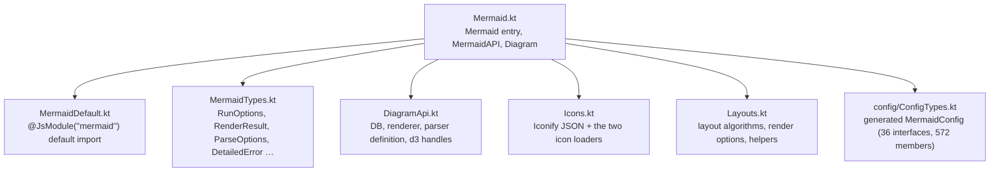

# Design notes

How the declarations are organised, what is generated, and where the wrapper deliberately stops
being precise.

## One file per area

| File | Contents |
| --- | --- |
| `Mermaid.kt` | the `Mermaid` entry interface, the `mermaid` accessor, `MermaidAPI`, `Diagram` |
| `MermaidDefault.kt` | the `@JsModule("mermaid")` default import |
| `MermaidTypes.kt` | `RunOptions`, `RenderResult`, `ParseOptions`, `ParseResult`, `DetailedError`, `UnknownDiagramError`, `InitNodes`, `parseOrNull` |
| `DiagramApi.kt` | the diagram-definition contracts: `DiagramDB`, `DiagramRenderer`, `ParserDefinition`, `DiagramDefinition`, `ExternalDiagramDefinition`, `DiagramOrientation`, the d3 selection handles |
| `Icons.kt` | the Iconify JSON shapes and the two icon-loader kinds |
| `Layouts.kt` | `LayoutAlgorithm`, `LayoutLoaderDefinition`, `RenderOptions`, `LayoutData`, `InternalHelpers` |
| `config/ConfigTypes.kt` | the generated `MermaidConfig` tree |

The split follows the upstream declaration files: a type lives next to the feature that owns it, so
`DiagramRenderer` is not buried in a file about the entry point.


A page therefore touches one entry object (`mermaid`) and one config record; everything else is
grouped by the upstream file it came from.

## The configuration tree is generated

`MermaidConfig` is 36 interfaces and 572 members. Hand-copying them would be wrong within one
upstream minor release, so `scripts/generate-config.py` reads `node_modules/mermaid/dist/config.type.d.ts`
and emits `config/ConfigTypes.kt`:

```bash
./gradlew kotlinNpmInstall          # put mermaid's declarations under node_modules
python scripts/generate-config.py    # rewrite ConfigTypes.kt
```

The generator is not a general TypeScript-declaration parser: it understands the shapes this file
contains (`interface`, `extends`, inline object literals, `Partial<…>`, string/number literal unions,
`Record<K,V>`) and fails loudly on anything else. What it emits:

- interface → `external interface`, inheritance copied from upstream;
- inline object literal → a hoisted interface named `<Owner><Field>`;
- `string | number` → the shared `StringOrDouble`;
- string literal union → `sealed external interface` + one `(String)` factory + an `Xs` constants
  object holding one `inline val` per upstream literal;
- literal union mixed with a type (`boolean | ('arc' | 'gap')`) → a plain `external interface` with one
  factory per branch plus the constants object;
- a subtype that redeclares an inherited member → marked `override`; when the type differs the member
  is renamed `typed<Name>` and mapped back with `@JsName`.

The output carries a `Generated by` header. Hand edits are lost on the next run: change the script, or
record the exception in [coverage.md](https://github.com/shijianjs/ktjs-mermaid/blob/main/docs/development/coverage.md).

## What is opaque, and why

Some upstream types describe structures nobody builds by hand, or d3 helpers Kotlin/JS cannot model
directly. They stay `external interface` handles so the signatures remain honest:

| Type | Why it is a handle |
| --- | --- |
| `LayoutData` | the graph a custom layout receives; upstream describes several hundred lines of it, and a layout only passes it straight back |
| `InternalHelpers` | upstream marks it deprecated and internal ("definitions will change without notice"); `InternalHelpers.helper(name)` reads a single helper |
| `SVG`, `SVGGroup`, `HTML` | d3 selections — kotlin-wrappers does not model d3 |
| `StyleClasses` | upstream is `Map<string, DiagramStyleClassDef>`, and kotlin-wrappers' `JsMap` bounds its keys by `JsAny?`, which a Kotlin `String` key does not satisfy; `StyleClasses.styleClass(id)` reads an entry |

## Two upstream quirks worth writing down

- **The default export.** mermaid's entry has a single `default` export. An `external object` for the
  module namespace compiles to a *named* import (`import { MermaidModule } from "mermaid"`), which
  webpack rejects at bundle time; a top-level `external val` with `@JsName("default")` is what produces
  a default import. The module declares exactly one such value.
- **The container must not share the diagram's id.** `mermaid.render(id, text, container)` looks its
  svg up by `id` in the document. Passing a container that already carries that id makes mermaid
  measure the container instead of the svg, and rendering dies with
  `svg.node(...)?.getBBox is not a function`.

## Testing

The module's tests run in Chromium, because a diagram is only real once it is measured and laid out.
Each case calls the library: render into a container and insert the result, parse valid and invalid
text, detect types, read the configuration back after `initialize`, wrap the literal unions, and reach
`Diagram` through `mermaidAPI`. Literal constants are asserted against the upstream strings, so a
regenerated config file cannot silently drift.

Coverage of the public surface, including what is deliberately not wrapped, is tracked in
[coverage.md](https://github.com/shijianjs/ktjs-mermaid/blob/main/docs/development/coverage.md).
