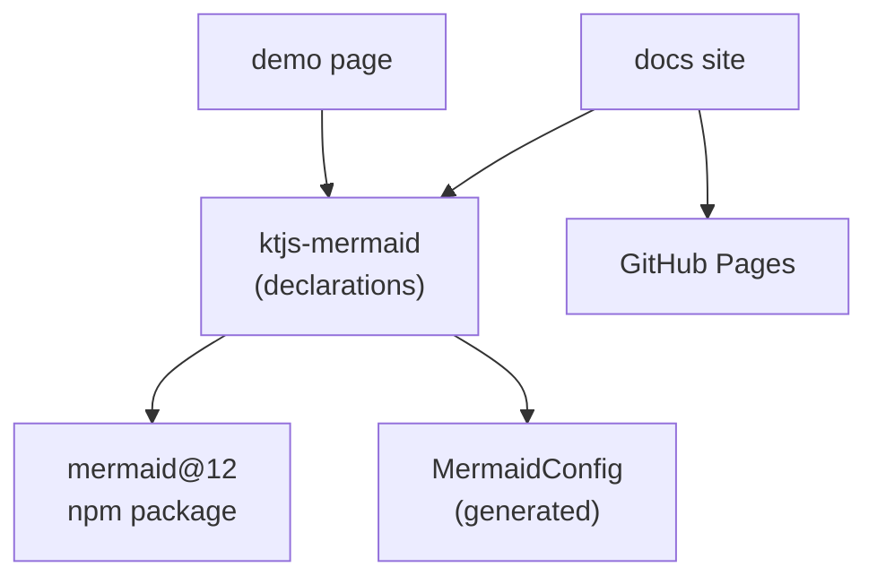

# Introduction

`ktjs-mermaid` is a Kotlin/JS wrapper for [mermaid](https://mermaid.js.org/), the diagramming
library that turns `graph TD; A-->B` into SVG. It maps the whole public surface of the npm package
`mermaid@12.3.0` onto `external` declarations the compiler checks: the entry object, the render and
parse results, the icon-pack and layout registries, the `Diagram` and `DiagramAPI` types behind them,
and the complete `MermaidConfig` tree.

## What is in it

| Part | Role |
| --- | --- |
| `ktjs-mermaid` | the wrapper: one npm package (`mermaid`), one Gradle module, one Kotlin package `io.github.shijianjs.ktjs.mermaid` |
| `demo` | a page that renders diagrams through the wrapper, with preset sources and a theme selector; published under `/demo/` |
| `docs` | this site: Kotlin configuration, Markdown pages, built by the [ktjs-docusaurus](https://github.com/shijianjs/ktjs-docusaurus) Gradle plugin |
| the rest | npm versions in one `package.json`, per-module `-kt.N` revisions, Detekt, Playwright browser tests, Maven Central release through the hub, Pages workflow |

The API reference under `/api/` is Dokka output for the published module — the same Dokka run that
`pagesSite` assembles next to this site.

## Two things worth knowing up front

- **It needs a DOM.** mermaid measures the diagram it renders (`getBBox`), so the wrapper is a
  browser library: there is no Node target and the tests run in Chromium.
- **`startOnLoad` stays off.** The wrapper never renders on its own; you call `mermaid.initialize`
  once and then `mermaid.render` (or `mermaid.run`) where and when you want a diagram.

## Where to go next

- [Getting started](guide/getting-started.md) — the coordinate, the three calls that matter, configuration.
- [Design notes](guide/design.md) — how the declarations are organised, what is generated, what stays
  opaque and why.

## How the pieces fit together

