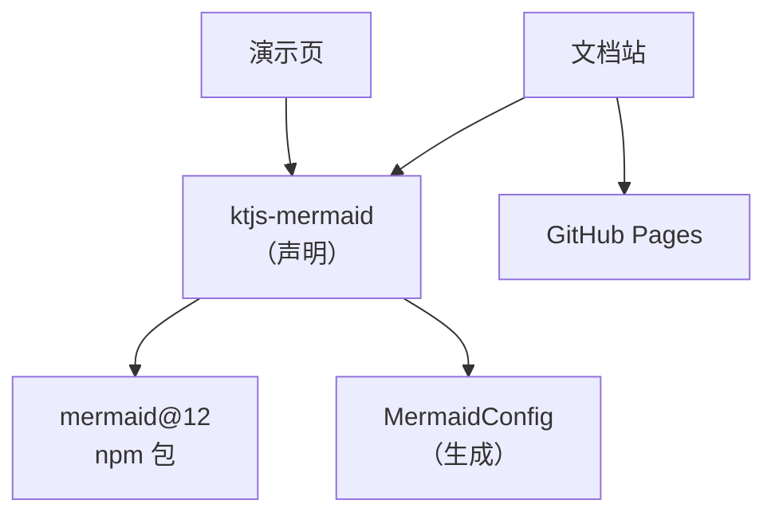

# 简介

`ktjs-mermaid` 是 [mermaid](https://mermaid.js.org/) 的 Kotlin/JS wrapper。mermaid 把
`graph TD; A-->B` 这样的文本渲染成 SVG，这个 wrapper 把 npm 包 `mermaid@12.3.0` 的公开 API
映射成编译器可检查的 `external` 声明：入口对象、渲染与解析结果、图标包与布局注册表，
它们背后的 `Diagram` 与 `MermaidAPI`，以及整棵 `MermaidConfig`。

## 仓库里有什么

| 部分 | 作用 |
| --- | --- |
| `ktjs-mermaid` | wrapper 本体：一个 npm 包（`mermaid`）、一个 Gradle 模块、Kotlin 包 `io.github.shijianjs.ktjs.mermaid` |
| `demo` | 演示页：用 wrapper 渲染图表，可切换预置源码与主题，发布在 `/demo/` |
| `docs` | 本站：Kotlin 配置 + Markdown 页面，由 [ktjs-docusaurus](https://github.com/shijianjs/ktjs-docusaurus) 的 Gradle 插件组装 |
| 其余 | npm 版本集中在一个 `package.json`、每模块 `-kt.N` 修订号、Detekt、Playwright 浏览器测试、经 hub 发布到 Maven Central、Pages 工作流 |

`/api/` 下是发布模块的 Dokka 产物，与本站一起由 `pagesSite` 组装。

## 先知道这两点

- **需要 DOM。** mermaid 渲染时要量尺寸（`getBBox`），所以这是浏览器端的库：没有 Node 目标，
  测试跑在 Chromium 里。
- **`startOnLoad` 关着。** wrapper 不会自己渲染：先 `mermaid.initialize` 配置一次，再在需要的地方
  调用 `mermaid.render`（或 `mermaid.run`）。

## 接下来

- [快速开始](guide/getting-started.md) —— Maven 坐标、三个关键调用、配置写法。
- [设计说明](guide/design.md) —— 声明怎么组织、哪些是生成的、哪些故意保持不透明。

## 各部分的关系

